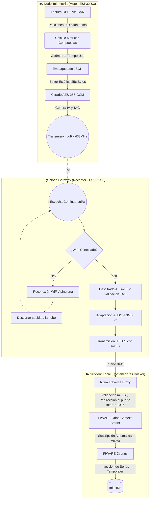

# Documentación Técnica: Ecosistema de Telemetría Honda CB300F

Este documento describe la arquitectura técnica, el diagrama de flujo de trabajo, el esquema de conexiones y la guía detallada de despliegue del sistema de telemetría IoT de extremo a extremo. Está diseñado para la captura de datos de diagnóstico (OBD2) vía bus CAN y su transmisión segura usando LoRa, mTLS, FIWARE y almacenamiento de series de tiempo.

---

## 1. Diagrama de Flujo del Sistema (Workflow)

El siguiente diagrama ilustra el comportamiento esperado del sistema, detallando cómo cada nodo procesa la información y cómo la infraestructura la ingiere a través de los diversos contenedores.



### Características Clave de la Arquitectura
* **Seguridad Criptográfica (Zero-Trust):** Todos los buffers estáticos (texto plano y ciphertext) utilizan **256 bytes** para prevenir desbordamientos de memoria al procesar la encriptación por hardware a través de `mbedtls`.
* **Escucha Ininterrumpida:** El Gateway receptor prioriza la recolección de paquetes LoRa. Si la red WiFi falla, el flujo no se bloquea; se lanza un intento de reconexión asíncrona cada 5 segundos y los paquetes se descartan internamente hasta restablecer la conexión al proxy.

---

## 2. Guía Detallada de Puesta en Marcha

Siga estas instrucciones en orden exacto a través de su consola (CMD o PowerShell) para inicializar los servicios y el hardware.

### Fase 1: Inicialización de la Infraestructura Cloud/Local (Docker)

Esta fase levanta las bases de datos (MongoDB, InfluxDB), Orion, Cygnus y el proxy seguro Nginx.

1. **Abrir PowerShell** en la raíz del proyecto (`telemetria-esp32`).
2. **Generar los certificados mTLS:** (Solo necesario la primera vez). Este script usará Docker de forma temporal para generar la infraestructura PKI y evitar instalaciones adicionales.
   ```powershell
   .\scripts\generate_certs.ps1
   ```
   *Al finalizar, la carpeta `certs/` se llenará con las llaves seguras.*
3. **Levantar los contenedores en segundo plano:**
   ```powershell
   docker-compose up -d
   ```
4. **Verificar que todos los servicios estén listos:**
   ```powershell
   docker-compose ps
   ```
   *(Asegúrese de que `orion`, `mongo-db`, `influxdb`, `nginx` y `cygnus` digan "Up").*

### Fase 2: Configuración del Ecosistema FIWARE

Es necesario configurar a Orion para que redirija las actualizaciones de los sensores automáticamente al historiador Cygnus.

1. **Ejecutar el script de suscripción:**
   Desde la misma terminal PowerShell, lance el siguiente comando que inyectará la petición a Orion usando los certificados a través del Nginx:
   ```powershell
   powershell -ExecutionPolicy Bypass -File .\scripts\setup_subscription.ps1
   ```
2. **Validación:** Si la terminal responde con un `HTTP 201 Created`, la regla se ha establecido exitosamente.

### Fase 3: Flasheo y Arranque del Nodo Gateway (Receptor)

El Gateway debe configurarse primero para asegurar que haya un dispositivo oyente.

1. **Conectar el ESP32-S3** asignado al Gateway por USB.
2. **Configurar Credenciales:** En el archivo `src/gateway.cpp`, actualice las variables `ssid` y `password` con los datos de su red WiFi. Copie y pegue los contenidos de `ca.crt`, `client_esp32.crt` y `client_esp32.key` en las variables de certificados del mismo archivo.
3. **Compilar y flashear:**
   ```powershell
   pio run -e gateway_node -t upload
   ```
4. **Abrir el monitor serial para validar conexión:**
   ```powershell
   pio run -e gateway_node -t monitor
   ```
   *Debe visualizar: `WiFi Conectado! IP: ...` y `Gateway listo y escuchando en la frecuencia...`.*

### Fase 4: Flasheo y Arranque del Nodo de Telemetría (Motocicleta)

1. **Conectar el segundo ESP32-S3** asignado a la Moto por USB.
2. **Compilar y flashear:**
   ```powershell
   pio run -e telemetry_node -t upload
   ```
3. **Monitorear la operación del sistema:**
   ```powershell
   pio run -e telemetry_node -t monitor
   ```
   *El microcontrolador inicializará LoRa y el bus CAN. Comenzará a leer datos y en pantalla verá el empaquetado: `Transmision Segura OK: IV(12) + TAG(16) + CIPHERTEXT` cada segundo.*

---

## 3. Diccionario de Datos Esperado

### Payload Interno de Radio (Zero-Trust LoRa)
El nodo de la motocicleta empaqueta temporalmente en su buffer de 256 bytes este JSON antes de cifrarlo.

```json
{
  "rpm": 1250.5,
  "speed": 45,
  "temp": 82,
  "odo": 1.25,
  "time": "00:15"
}
```

### Formato Final en la Nube (NGSI v2 - FIWARE)
Al llegar al Gateway, es descifrado y adaptado a este estándar para ser inyectado a Nginx (`puerto 8443`).

```json
{
  "rpm": { "type": "Number", "value": 1250.5 },
  "speed": { "type": "Number", "value": 45 },
  "engineTemp": { "type": "Number", "value": 82 },
  "throttlePosition": { "type": "Number", "value": 0 }
}
```

---

## 4. Esquema de Conexiones Físicas (Pinout)

Ambos microcontroladores **ESP32-S3** deben estar cableados según la siguiente tabla para el correcto funcionamiento de los periféricos.

| Módulo Físico | Pin del Módulo | Pin ESP32-S3 | Función Principal |
| :--- | :--- | :--- | :--- |
| **SN65HVD230 (CAN)** | CTX (TX) | **GPIO 5** | Transmisión hacia el bus de la moto |
| **SN65HVD230 (CAN)** | CRX (RX) | **GPIO 4** | Recepción desde el bus de la moto |
| **SX1278 (LoRa)** | SCK | **GPIO 12** | Reloj del hardware FSPI |
| **SX1278 (LoRa)** | MISO | **GPIO 13** | SPI Master In Slave Out |
| **SX1278 (LoRa)** | MOSI | **GPIO 11** | SPI Master Out Slave In |
| **SX1278 (LoRa)** | NSS | **GPIO 10** | Chip Select / Activación |
| **SX1278 (LoRa)** | RST | **GPIO 9** | Reset por hardware |
| **SX1278 (LoRa)** | DIO0 | **GPIO 14** | Interrupción de paquete listo |

---

## 5. Visualización: Dashboard Web Interactivo (HTML)

El sistema ahora cuenta con un portal gráfico de alto rendimiento (diseño *Glassmorphism*) para visualizar las métricas de la motocicleta en tiempo real desde cualquier teléfono o PC en la misma red.

### Fase 5: Levantar el Dashboard de Monitoreo

No se necesitan servidores web pesados (NodeJS, Apache, Grafana). Todo funciona puramente en su navegador web consultando directamente a Orion a través del puerto 1026 (configurado con CORS seguro).

1. **Asegurar que Docker está corriendo:**
   Si apagó el entorno previamente o aplicó los cambios de CORS recientes, recargue Docker. Ejecute en su consola:
   ```powershell
   docker-compose down
   docker-compose up -d
   ```
2. **Abrir el Dashboard:**
   Navegue hasta la carpeta `/dashboard` de este repositorio en su explorador de archivos de Windows.
3. **Ejecutar:**
   Haga **doble clic en `index.html`** para abrirlo en Chrome, Edge o Firefox. 
4. **Verificación Visual:**
   - La página debe mostrar un fondo oscuro animado.
   - Las agujas de RPM y Velocidad se dibujarán apenas lleguen datos.
   - Podrá usar el botón azul de "**Lanzar OTA a la Moto**" para seleccionar y enviar su compilado `.bin` directamente desde la misma web.
